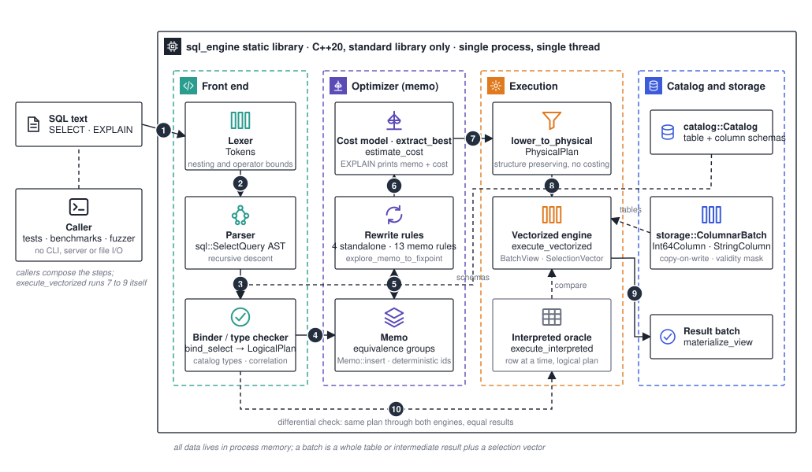

# Architecture

A columnar analytical engine whose hardest boundary is the optimizer: SQL is parsed and bound into relational algebra, rules produce equivalent plans, and a Cascades-style memo chooses a low-cost vectorized physical plan without changing semantics.

This page is the map: the stages, how one query travels through them, and where the correctness claims are checked. The numbers on the diagram match the list below. The cost formulas, the rule proofs and the kernel design are in [`../ARCHITECTURE.md`](../ARCHITECTURE.md); the rules the code must never break are in [`../INVARIANTS.md`](../INVARIANTS.md).

## One query, end to end

There is no single `run(sql)` entry point. Callers (tests, benchmarks, the fuzzer) compose the stages; `execute_vectorized` performs steps 7 to 9 itself, and the optimizer stage (4 to 6) is optional.

1. **SQL text → lexer.** The lexer turns the text into tokens and enforces the nesting depth (`kMaxNestingDepth = 64`) and boolean operator (`kMaxBooleanOperators = 200`) bounds.
2. **Lexer → parser.** A hand-written recursive-descent parser (`sql::parse_select`) builds a `sql::SelectQuery` AST. Errors carry a position: `parse error at position N: …`.
3. **Parser → binder.** `sql::bind_select` resolves names against a `catalog::Catalog`, types every expression (`Int64` or `String`), normalises `RIGHT` joins to `LEFT`, tracks correlation depth for subqueries, and produces a typed `plan::LogicalPlan` (`Scan`, `Join`, `Filter`, `Project`, `Aggregate`, `Window`, `Distinct`, `Sort`, `Limit`, `Explain`).
4. **Binder → memo.** `Memo::insert` places the plan into equivalence groups bottom-up with deterministic group ids.
5. **Memo ↔ rewrite rules.** `explore_memo_to_fixpoint(default_memo_rules())` applies the thirteen memo rules (semi and anti join introduction for `EXISTS`, `NOT EXISTS`, `IN` and `NOT IN`, including their correlated forms; `LeftJoinToInnerRule`; `FilterIntoJoinRule`; `FilterThroughAggregateRule`; `JoinCommuteRule`; `JoinAssociateRule`) until no group gains a new expression. Four standalone rules (`ConstantFoldComparisonRule`, `MergeAdjacentFiltersRule`, `AlwaysFalseFilterRule`, `DropAlwaysTrueFilterRule`) run outside the memo through `rewrite_to_fixpoint`. Every rule file carries a proof section in the shape of [`rewrite-rule-template.md`](./rewrite-rule-template.md).
6. **Rules → cost model.** `extract_best(root, catalog)` costs each alternative with `estimate_cost` (selectivities 0.10 for equality, 0.90 for inequality, one third for range predicates; equi-join rows `|L|·|R| / max(distinct)`; sort `rows·log2(rows)`) and returns the chosen `LogicalPlan`. `EXPLAIN` stops here and prints `bound logical plan:`, `memo exploration:`, `chosen plan:` and `total cost:` as a one-column batch.
7. **Cost model → physical plan.** `plan::lower_to_physical` maps the chosen plan one-to-one onto a `PhysicalPlan`. It adds no costing and no reordering, and rejects residual correlated subqueries with `vectorized execution does not support residual correlated subqueries at position N`.
8. **Physical plan → vectorized engine.** `execute_vectorized` walks the operators recursively (`execute_scan` … `execute_limit`). Each operator returns a `BatchView`: a reference to a whole table or intermediate batch plus an immutable `SelectionVector`. Kernels are compiled once per operator (`KernelDispatch::Int64Only` or `Typed`) and use `is_true` and `is_known` masks for three-valued logic.
9. **Vectorized engine → result batch.** `materialize_view` turns the final view into a `storage::ColumnarBatch`.
10. **Differential check.** `differential::compare_engines` runs the same bound plan through the interpreted oracle (`execute_interpreted`, row at a time, directly on the logical plan) and through the vectorized engine, for the unrewritten plan, the standalone-rewritten plan, every memo alternative, and the chosen plan, then compares exactly (sorted-bag equality plus sortedness and the `LIMIT` validity contract).

## Components

| Component | Responsibility | Where to look |
| --- | --- | --- |
| Lexer and parser | Tokens and `sql::SelectQuery` | `src/sql/parser.cpp`, `include/sql/ast.hpp`, `include/sql/errors.hpp` |
| Binder | Typed `LogicalPlan` from AST and catalog | `include/sql/binder.hpp`, `src/sql/binder.cpp` |
| Logical plan | `LogicalKind`, `JoinKind {Inner, Left, Semi, Anti, NullAwareAnti}` | `include/plan/logical_plan.hpp` |
| Rewrite rules | `Rule` (standalone) and `MemoRule` (memo host), proof-commented | `include/optimizer/rewrite.hpp`, `src/optimizer/rewrite.cpp` |
| Memo and cost model | Groups, exploration, `estimate_cost`, `extract_best`, `extract_alternatives` | `include/optimizer/memo.hpp`, `src/optimizer/memo.cpp` |
| EXPLAIN | Plan text as a batch | `src/optimizer/explain.cpp` |
| Physical plan | `lower_to_physical` | `include/plan/physical_plan.hpp` |
| Interpreted oracle | Row-at-a-time reference execution | `src/execution/interpreter.cpp` |
| Vectorized engine | `BatchView`, `SelectionVector`, typed kernels | `src/execution/vectorized.cpp` |
| Catalog and storage | `catalog::Catalog` (schemas), `execution::Catalog` (schemas plus batches), `ColumnarBatch`, `Int64Column`, `StringColumn` with copy-on-write values and an optional validity vector | `include/catalog/catalog.hpp`, `include/storage/columnar_batch.hpp` |
| Tests | Eight CTest executables, `differential_verifier.hpp` | `tests/` |
| Benchmarks | `sql_bench` (13 workloads) and `yard_export` | `benchmarks/`, [`benchmarks.md`](./benchmarks.md), [`yard/`](./yard/) |
| Fuzzing | libFuzzer target `sql_parser_planner_fuzz` with a committed corpus; seeded `sql_fuzz_differential` | `fuzz/`, `tests/sql_fuzz_differential.cpp` |

## Boundaries

- **Shape.** One static library, `sql_engine`, with public headers under `include/`. Eight test executables, two standalone benchmark binaries, and an optional Clang-only fuzzer behind `SQL_ENGINE_BUILD_FUZZER`. No CLI, REPL, server or network. One process, one thread.
- **Data.** Tables are `storage::ColumnarBatch` values held by an `execution::Catalog`, built in code by tests and benchmarks. The library performs no file I/O; the only files written are the yard export's JSON and Markdown.
- **Batches.** A batch is a whole table or intermediate result plus a selection vector. There is no fixed vector size and no chunked pipeline; "batch at a time" means each operator compiles its expressions once.
- **Dependencies.** The C++20 standard library and CMake 3.20 or newer. The storage layout is Arrow-like in spirit; Arrow is not linked. There are no SIMD intrinsics.

## What is checked, and where

| Claim | Evidence |
| --- | --- |
| Costing may choose among equivalents but never creates semantics; the vectorized output equals the interpreted oracle; output order is deterministic; missing statistics and memo violations fail loudly | `INVARIANTS.md`, the differential tests |
| A delivered differential run: 160 seeds, 5,381 memo alternatives, 13,223 execution paths, 195 uncorrelated and 27 correlated null-aware anti-join firings | `ARCHITECTURE.md` |
| Eight CTest binaries on Ubuntu and macOS, plus an ASan and UBSan job | `.github/workflows/ci.yml` |
| Fuzz corpus replay is a blocking CI gate; a 90 s discovery run is advisory. The fuzzer parses, binds and plans against a fixed schema-only catalog; it executes nothing | `.github/workflows/ci.yml`, `fuzz/` |
| Speedups of the vectorized engine over the oracle, measured on one Apple M2 at `-O2 -DNDEBUG`, five repetitions, checksum before timing | [`benchmarks.md`](./benchmarks.md) |

Read the benchmark numbers with their caveat: the interpreted oracle uses nested-loop joins, so the large join speedups measure distance from a naive baseline on one machine, not a comparison with another engine. Nothing in the repository claims multi-threading, persistence, TPC-H or cross-engine results.

## Facts the code relies on

- Namespaces `sql`, `catalog`, `plan`, `optimizer`, `storage`, `execution`, `bench`, `differential`.
- The AST's `sql::JoinKind {Inner, Left, Right}` differs from the plan's `plan::JoinKind`; `Right` is gone after binding.
- `AggregateFunction {Count, Sum, Min, Max}`; `WindowFunction {RowNumber, Rank, DenseRank, Count, Sum, Min, Max}`; `WindowFrame {WholePartition, RangeCumulative, RowsCumulative}`.
- `AlternativeExtractionOptions` defaults to `{64, 256}`; the differential harness uses `{256, 4096}` and the yard export `{128, 1024}`.
- CMake targets: `sql_engine`, `sql_smoke`, `sql_golden`, `sql_vectorized_differential`, `sql_fuzz_differential`, `sql_catalog_binder`, `sql_rewrite_rules`, `sql_optimizer_memo`, `sql_optimizer_cost_model`, `sql_bench`, `yard_export`, `sql_parser_planner_fuzz`.
